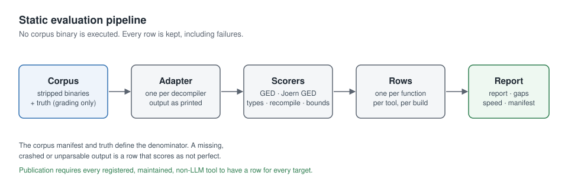
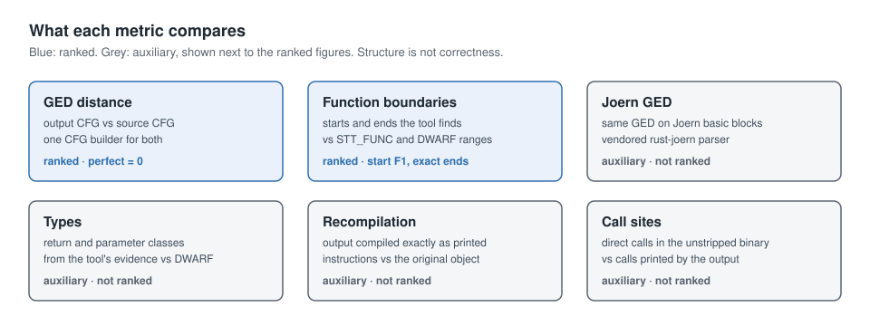

# FreshBench

[](https://github.com/fission-systems/freshbench/actions/workflows/test.yml)

FreshBench is a static decompiler benchmark. It measures how close a decompiler's
output is to the original C function, and it shows each decompiler where it can
improve. It does not measure whether the output is correct.

It uses recent, license-clean C programs chosen to lie outside the corpora
decompilers are usually tuned on. DecBench's functions are excluded by
fingerprint, which lowers the chance that a tool has seen a function; it does not
prove it. FreshBench has its own ground truth and metrics, written in Rust in
[`crates/freshbench`](crates/freshbench/).

> **Status (2026-11-25):** The scorer, CFG builders, GED, type and recompile
> metrics, `gaps` and manifests are implemented and tested. The M1 corpus is
> published ([`corpus/m1`](corpus/m1/README.md)). Tool results on M1 are in progress.



## Contents

- [Quick start](#quick-start)
- [What is measured, and what is not](#what-is-measured-and-what-is-not)
- [How GED is computed](#how-ged-is-computed)
- [Corpus M1](#corpus-m1)
- [Publication](#publication)
- [Improvement targets](#improvement-targets-freshbench-gaps)
- [Sweep and speed](#sweep-and-speed)
- [Layout](#layout)
- [Prior work and license](#prior-work-and-license)

## Quick start

```bash
cargo build --release --locked -p freshbench
target/release/freshbench --help

# Check the corpus you downloaded against the pinned manifest
target/release/freshbench manifest verify data/m1 corpus/m1/manifest.jsonl.gz
```

Tests and lints (run from the repository root; see [`AGENTS.md`](AGENTS.md)):

```bash
cargo fmt -p freshbench --check
cargo clippy --locked -p freshbench --all-targets -- -D warnings
cargo test --locked -p freshbench
```

The minimum supported Rust version is 1.90 (`rust-version` in `Cargo.toml`).

### Optional error reporting (Sentry)

Build with `--features sentry` to report panics to Sentry. Nothing is sent unless
both variables are set at run time:

```bash
FRESHBENCH_SENTRY=1 SENTRY_DSN=<project DSN> target/release/freshbench <command>
```

Without the feature, no Sentry code is compiled. With it, reporting stays off
until both variables are set, and only panics are reported (errors a command
returns are not).

What a report contains is an allowlist in `crates/freshbench/src/telemetry.rs`:
the exception type (`panic`), the panic location as `file:line` when the file is
FreshBench's own source, the Rust standard library or a crates.io dependency,
stack frames reduced to function names in FreshBench, the standard library or
Rayon (others read `<other>`) with the same file rule, and release, environment,
level, timestamp and SDK version. The panic message is never sent, because it can
hold whatever the code was looking at; it is replaced by `panic at <location>`.
Paths outside those three forms, other tags, extra data, contexts, breadcrumbs,
loaded modules, host and user details are dropped. Binaries, corpus source,
decompiled output and memory are never read into a report, and no environment
variable is besides the opt-in pair, `SENTRY_RELEASE`/`FRESHBENCH_RELEASE` (kept only
as `freshbench@<version>`) and `SENTRY_ENVIRONMENT` (kept only from a fixed list).
The scrub is tested, not proven: a value shaped exactly like a FreshBench source
path or function name in a stack frame is kept, since those come from the
binary's own debug information.

Measurements run with telemetry off. `decompile`, `boundaries` and `sweep run`
refuse to start while `FRESHBENCH_SENTRY`, `FISSION_SENTRY` or `SENTRY_DSN` is
set, because the measured tool inherits the environment and its timings and
output must not depend on error reporting. Debug a crash in a separate,
instrumented run of another command (for example `score` or `rescore`), and never
publish numbers from it.

The repository secrets `SENTRY_ORG`, `SENTRY_PROJECT` and `SENTRY_AUTH_TOKEN` are
reserved for uploading releases and debug files; no workflow uses them yet.
`SENTRY_ORG` is the Sentry organization slug (`fission-systems`). It is a Sentry
setting, not the GitHub organization; the two names happen to be the same here.

## What is measured, and what is not

**Measured:** how close the output is to the source, and a static agreement
signal against the binary.



**Ranked.** The main metrics are GED distance from the source (mean, median, and
rows at 0 over every row; a row without a score is charged the whole source
graph) and function boundaries (start F1 and exact ends of the functions a tool
finds by itself, with and without unwind tables). Speed is reported next to them.

**Auxiliary.** Perfect rates, Joern GED, types and recompilation (byte match) are
shown but not ranked.

| metric | compares | perfect |
|---|---|---|
| GED | the output's CFG vs the source function's CFG, both built by FreshBench's one CFG builder (`cfg.rs`) | 0 |
| Joern GED | the same comparison on Joern's basic-block CFG (vendored rust-joern, `joern.rs`), scored with the same GED engine | 0 |
| types | return and parameter type classes (`int<N>`, `float<N>`, bool, ptr, array, struct, void) vs DWARF (`types.rs`, `dwarf.rs`); locals as coverage only | arity, every parameter and the return right |
| recompile | the output exactly as printed, built by the binary's own compiler and flags plus one fixed permissive flag set; its instructions vs the original's, with every constant, displacement and register kept (`recompile.rs`) | instruction-identical |
| Union | any of GED, Joern GED, types or recompile perfect | |
| Intersection, strict | every applicable metric perfect; GED 0 on both graph families; GED 0 from output that parsed without error recovery | |
| with control flow | perfect rate over rows whose source has a branch or loop. A source without control flow matches any output without control flow, so those perfects are also reported as their own `straight-line` band | |
| size bands | every table split by source CFG nodes: straight-line (≤2), 3–5, 6–20, 21–50, 51–100, >100 | |
| normalized GED | GED / (source nodes + edges) | 0 |
| call sites | direct call instructions in the unstripped binary vs calls printed (`callsites.rs`) | nothing missing, nothing extra |
| shape tags | over/under-noded, extra goto/return/ternary/calls, lost `&&`/`||`, lost switch (`taxonomy.rs`) | |
| function boundaries | the tool gets no addresses and lists the functions it finds in the stripped binary; starts and ends are compared with the unstripped binary's `STT_FUNC` symbols and DWARF ranges (`boundaries.rs`). Variants: `as-built` and `no-unwind` (`.eh_frame`, `.eh_frame_hdr`, `.ARM.exidx`, `.ARM.extab` zeroed, since they reveal exact function ranges) | start precision/recall/F1; exact and padded ends |

**Line mappings are required.** Every decompiled function must come with the
tool's own line mappings (which instructions each output line came from) and,
for types, its variables with ABI argument positions and stack slots. Addresses
are checked against the function's instructions. An output with no valid line
mapping is not scored. Types are matched to DWARF through this evidence only,
never by reading the C text. GED still reads the output's C, since structure is
what it measures.

**No fixups.** Every metric reads the output exactly as printed. FreshBench does
not rewrite keywords, define pseudo-types, inject declarations or repair code
before compiling or parsing it. Output that needs a declaration it did not print
fails to compile, and that counts against the decompiler that printed it. The
only uniform inputs are the compiler flags (`-w -fpermissive -std=gnu17
-fno-builtin` plus the build's own) and the rule for choosing the scored function:
the function with the source's name, else the only function defined in the output.

**Not measured: correctness.** GED sees only graph shape. A function that prints
the wrong constant, the wrong argument or an invented call can score perfect, and
recovering missing code can make the score worse. Call-site agreement checks that
each call is printed once, not that its arguments are right. A better score is
not evidence that a change is correct, and a worse one is not evidence that it
is wrong.

## How GED is computed

* **One CFG builder for both sides.** Source and output are parsed with
  tree-sitter-c and built by the same code, so two texts with the same control
  flow get the same graph.
  * `&&`, `||` and `?:` are control flow, as in machine code.
  * Literal conditions are folded (`while (1)`, `do {} while (0)`).
  * `goto`, `break`, `continue` and `return;` are edges, not blocks.
  * Calls to no-return functions end at EXIT.
  * Empty blocks are removed, chains are merged, and unreachable code is dropped.
* **Edit costs.** Inserting or deleting a node or an edge costs 1. Substituting a
  node costs 0 for the same label (ENTRY, EXIT, block) and 1 otherwise.
* **Search.** The lower bound is the size difference. The upper bound comes from a
  Hungarian node assignment plus deterministic local search. A branch-and-bound
  search then tightens it within a fixed work count, never a time limit. Each row
  records `exact` and `lower_bound`. A value of 0 is always exact.
* **Deterministic.** Identical inputs give byte-identical rows on any machine.
  `freshbench determinism` checks that no (function, output hash) pair has two
  scores.
* **Score cache.** A score is keyed by scorer, metrics revision, budget, function,
  source definition fingerprint and DWARF signature, and output hash. The metrics
  revision changes whenever a CFG builder or the vendored rust-joern changes, so a
  cache never returns a score from an older definition. `rescore --cache FILE`
  keeps the cache between runs.

## Corpus M1

| milestone | languages | architectures | compilers | optimization | status |
|---|---|---|---|---|---|
| **M1** | C | x86-64, i686, AArch64, ARMv7 (Thumb-2, hard float) | GCC 16.2.0, Clang 23.1.6 | O0 O1 O2 O3 Os O2-noinline | published ([`corpus/m1`](corpus/m1/README.md)); tool results in progress |
| M2 | C++, C | + PE/PDB | + MSVC, MinGW-w64 | | planned |
| M3 | Rust, Go | | rustc, gc | | planned; no C source CFG, so binary-grounded signals only |

M1 has 20 projects, 285,875 rows (functions per build), and 7,885 distinct source
functions. Rows overstate distinct functions because projects copy code between
files; see [how many functions M1 really is](corpus/m1/README.md#how-many-functions-this-really-is).

Rules:

* **Fresh, licensed sources.** Only GitHub projects with an OSI license. Each
  project's license file, SPDX id and commit ship with the dataset. GPL binaries
  ship with their preprocessed sources and upstream commit. No malware.
* **One exact toolchain per binary.** The build image is pinned by digest. Each
  manifest entry records the compiler version line, target and flags.
* **Stripped input only.** Decompilers see stripped copies. Names, addresses and
  types come from the unstripped original, for grading only.
* **Static only.** No corpus binary is executed.
* **Same functions across the matrix.** Selection order is
  sha256(`project/source/name`), independent of architecture and compiler.

Corpus files and results are on Hugging Face at a pinned revision
(`sjkim1127/freshbench-v2`, from M1 on). This repository holds only the manifests,
hashes and documentation. Git LFS is not used.

## Publication

The GitHub Pages workflow ([pages](../../actions/workflows/pages.yml)) builds the
public leaderboard from the completed `evaluate` runs listed in
[`ci/leaderboard_runs.json`](ci/leaderboard_runs.json). A push to `main` that
changes that file rebuilds and deploys the leaderboard. A manual dispatch can
supply other run IDs. The workflow downloads only the pinned M1 target manifests,
verifies their SHA-256 digests, and checks that at least two registered non-LLM
tools have a row for every M1 target. Explicit failed or unsupported rows count;
absent rows do not pass the gate. A run list that fails the gate deploys nothing,
so the currently published ranking stays as it is.

Publication rules:

* Only tools in [`ci/tools.json`](ci/tools.json) whose upstream repository had a
  commit within the last 365 days when the page is built. An unmaintained tool's
  numbers stay in the raw results but are not published.
* LLM-based decompilers are not ranked. The corpus is public, so a model may have
  seen it.
* Results on the whole corpus use `report --corpus`, so the denominator is the
  corpus and not the union of result files.
* Deduplicated views (one function per renamed-clone group) are published next to
  the all-row view.

A full rerun of M1 is one dispatch of the [sweep](../../actions/workflows/sweep.yml) workflow on
`main`. It tags the commit, starts every `evaluate` run from that tag, and
[sweep-collect](../../actions/workflows/sweep-collect.yml) checks the runs with the same gate once
they are done. When the gate passes it pushes a branch that sets `ci/leaderboard_runs.json` and
opens an issue linking it; publishing is still merging that change.

A manual dispatch with `deploy` false only produces the `leaderboard-preview`
artifact for inspection. The landing page is deployed from `site-bootstrap/` when
that directory changes on `main`; it contains corpus statistics and no rankings.

## Improvement targets: `freshbench gaps`

```bash
target/release/freshbench rescore <dataset> --tool <tool> --out rows/<tool>.jsonl
target/release/freshbench gaps <dir-with-rows> --tool <tool> --json gaps.json
```

For every function, the tool is compared with every other tool on the same row:

* **reachable:** another decompiler scored GED 0 from the same stripped binary and
  this one did not. This shows the source's shape is recoverable.
* **gap:** this tool's GED minus the best other tool's GED.
* **no score:** this tool has nothing scorable where another tool scored.

Results are grouped by size band, outcome and shape tag, with example rows, worst
first. These are similarity gaps, not correctness defects. Inspect the output
before acting on one.

## Sweep and speed

A quality loop for one decompiler under development:

```bash
target/release/freshbench sweep run data/m1 --cli <decompiler-cli> --repo <repo> --label main
target/release/freshbench sweep report runs/main
target/release/freshbench sweep diff runs/main runs/fix
```

* `run` writes `runs/<label>/` with `meta.json` (CLI sha256, commit, scorer id,
  function-set id, timings), one checkpoint per binary, and `rows.jsonl`. An
  interrupted run resumes from its checkpoints; a resume with another CLI or
  function set is refused.
* A call that crashes or times out is bisected until the failing function is
  alone; the other functions of the binary keep their output.
* `diff` compares output hashes first. Identical outputs are not compared on score.
  It refuses runs scored by different scorers.

Every tool run is timed in Rust: wall time, CPU time of the process tree, and peak
resident memory. CPU time is the figure to compare between tools.

```bash
target/release/freshbench speed results/ boundaries/
```

Decompiling costs far more than scoring. A warm score cache makes a before/after
comparison rescore only the rows whose output changed.

## Layout

| path | what |
|---|---|
| [`crates/freshbench/`](crates/freshbench/) | the scorer and CLI (Rust) |
| [`crates/rust-joern/`](crates/rust-joern/) | vendored rust-joern (Apache-2.0); see its `VENDORED.md` |
| [`adapters/`](adapters/) | decompiler adapters and their contract |
| [`corpus/`](corpus/) | pinned corpus manifests and digests |
| [`selection/`](selection/) | candidate enumeration and project lists |
| [`ci/`](ci/) | tool pins, tool registry, qualification and gate scripts |
| [`docs/`](docs/) | DecBench compatibility audit |
| [`.github/workflows/`](.github/workflows/) | tests, qualification, evaluation, Pages |
| [`assets/`](assets/) | diagrams used in this README |

## Prior work and license

FreshBench's metric families follow [DecBench](https://github.com/Noelo-Lab/decbench)
(Noelo-Lab): control-flow graph edit distance against the source, type recovery
against DWARF, recompilation byte match, and a Union of perfect scores. The
implementation is independent: it uses no DecBench code. For the second CFG family
it vendors [rust-joern](https://github.com/Noelo-Lab/rust-joern) (Apache-2.0),
but scores its graphs with FreshBench's GED, so its scores are not DecBench scores.
DecBench's maintainer agreed to this reuse of its metric design on 2026-11-25, with
one request we keep: be honest about duplication. The scoring defects DecBench
found are tracked against this implementation, each with its status and a
regression test, in
[`docs/decbench-compatibility-audit.md`](docs/decbench-compatibility-audit.md).

See [`NOTICE`](NOTICE) for attribution.

Harness: Apache-2.0 ([`LICENSE`](LICENSE)). Corpus files keep their projects' licenses.
